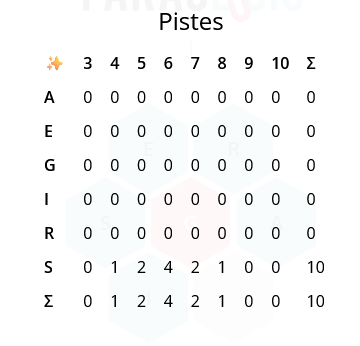

<h1 align="center">ParauPistes</h1>

<p align="center">
  <a href="https://addons.mozilla.org/firefox/addon/paraupistes/"></a>
  <a href="LICENSE"></a>
</p>

<p align="center"> Extensió de Firefox que afegeix pistes dinàmiques al <a href="https://vilaweb.cat/paraulogic/">Paraulògic</a> de VilaWeb. </p>
<p align="center">  </p>

Amb ParauPistes, les pistes del Paraulògic s'actualitzen soles a mesura que trobes paraules. D'un cop d'ull veus què has descobert i què et falta. ✨

També fa el seguiment de prefixos, sufixos, tutis, palíndroms, mots quadrats i combinacions.

<p align="center">  </p>

## Instal·lació

Disponible a [Firefox Add-ons](https://addons.mozilla.org/firefox/addon/paraupistes/).

## Com funciona

L'extensió reemplaça tot el contingut del quadre de pistes (la matriu, els prefixos i sufixos, els tutis, els palíndroms, els mots quadrats i les combinacions) per una versió dinàmica que es recalcula cada vegada que trobes una paraula.

## Desenvolupament

Per provar l'extensió sense publicar-la:

1. Clona el repositori:
   ```bash
   git clone https://github.com/Seifer23/paraupistes.git
   ```
2. Obre Firefox i vés a `about:debugging#/runtime/this-firefox`.
3. Clica **Carrega un complement temporal** i selecciona el fitxer `manifest.json` del repositori.

L'extensió queda activa fins que tanquis Firefox.

## Problemes i suggeriments

Obre una [issue](https://github.com/Seifer23/paraupistes/issues) al repositori.

## Llicència

[MPL-2.0](LICENSE)
